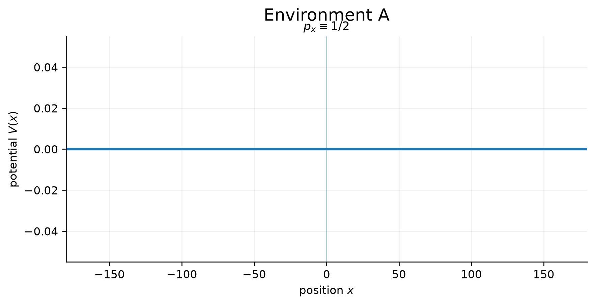
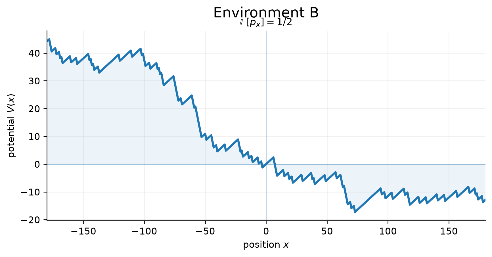
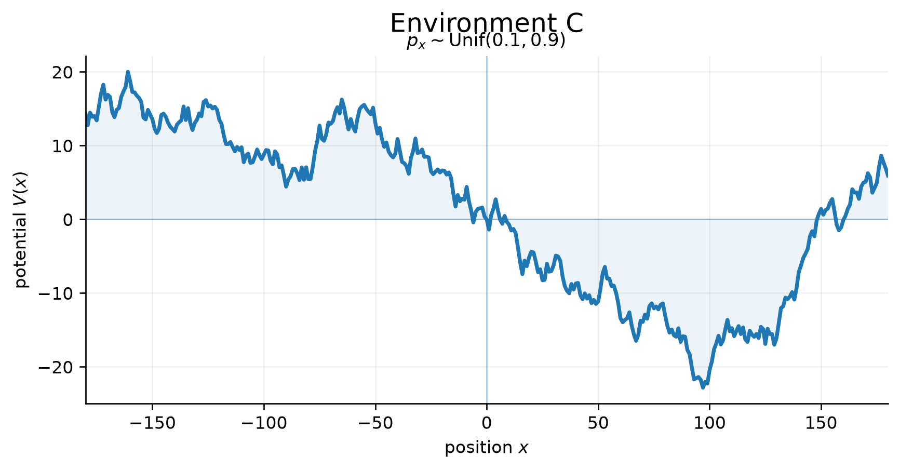
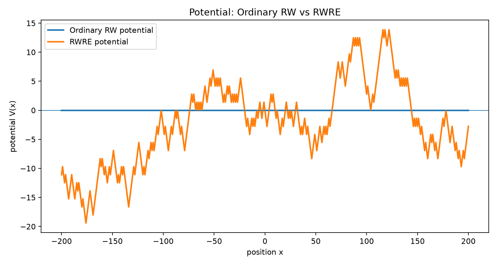
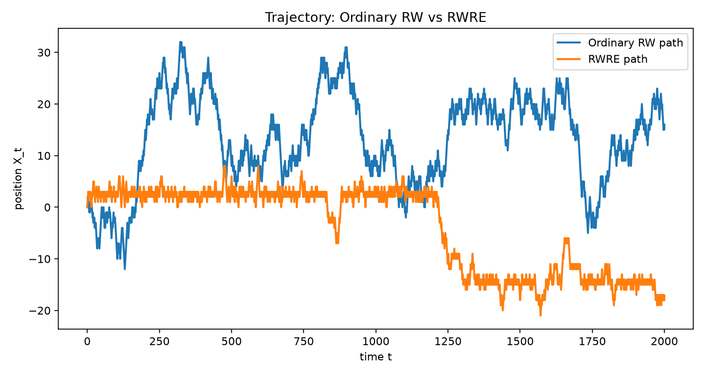
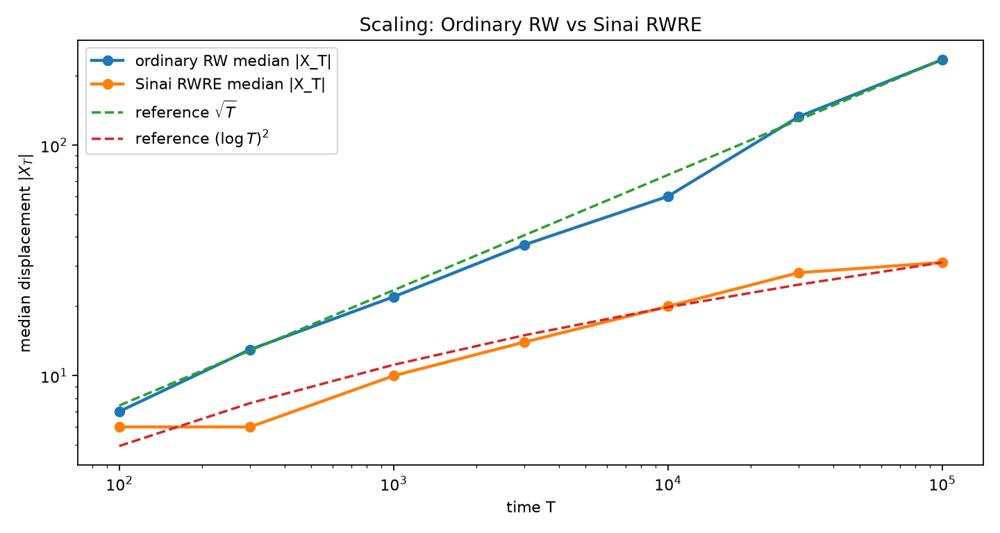

# Random Walk in Random Environment (RWRE)

A one-dimensional random walk whose transition probabilities are themselves random.
This repo holds my personal write-up and simulation code from a summer research program in the
Department of Applied Mathematics, NYCU.

**Poster:** [`RWRE_poster_my_version.pdf`](RWRE_poster_my_version.pdf)

> This is my own version of the material (poster and code). The program's official group poster
> was a joint effort and is not included here.

## Question

If the average transition probability is fair, E[p_x] = 1/2, is the walk fair too?

## Main ideas

- Write ρ_x = (1 − p_x) / p_x. In a fixed environment, the probability of reaching 0 before N
  has a closed form in the products of ρ.
- For i.i.d. environments, the strong law of large numbers makes the sign of E[log ρ] decide the
  long-term behavior:
  - E[log ρ] < 0: transient to the right
  - E[log ρ] = 0: recurrent
  - E[log ρ] > 0: transient to the left
- So E[p_x] = 1/2 does **not** imply a fair walk.
- The potential V(n) = Σ log ρ_i has valleys that trap the walker. In the recurrent (Sinai) case,
  the displacement slows from about √t to about (log t)².

## Figures

### Potentials

| Environment | Figure |
|---|---|
| A: p_x ≡ 1/2 |  |
| B: E[p_x] = 1/2 but E[log ρ] < 0 (transient) |  |
| C: p_x ~ Uniform(0.1, 0.9), E[log ρ] = 0 (recurrent) |  |

The `04`–`06` files in `rwre_figures/` are the same three potentials with annotations
(flat potential, deep valley, downward tilt).

### Potential, trajectory and scaling (Sinai RWRE vs. ordinary walk)

Generated by `rwre.py`, using the two-valued Sinai environment p_x ∈ {0.2, 0.8}
(each with probability 1/2, so E[log ρ] = 0).





- **Trajectory:** one ordinary walk and one RWRE path of length T = 2000. The RWRE path tends to
  stay near the bottom of a potential valley.
- **Scaling:** median |X_T| over 100 independent environments for T from 10² to 10⁵, on log–log
  axes, with scaled √T and (log T)² reference curves.

## Run it

```bash
pip install numpy matplotlib      # or: uv sync
python rwre_potential_plots.py    # potential figures -> rwre_figures/
python rwre.py                    # Figure_1/2/3 -> rwre_figures/
```

`rwre_potential_plots.py` writes figures to `rwre_figures/` and prints finite-sample estimates of
E[log ρ] for each environment.

`rwre.py` writes the three figures to `rwre_figures/` and prints the median-displacement
table. Parameters (seed, trajectory length `T`, `RWRE_MODE` = `"sinai"` or `"transient"`, number
of scaling trials) are at the top of the file. The scaling experiment simulates up to 10⁵ steps
× 100 trials in pure Python, so it takes a while; lower `SCALING_TRIALS` for a quick run.

## Files

- `rwre_potential_plots.py`: potential plots for the three environments
- `rwre.py`: potential, trajectory and scaling experiments (Sinai or transient RWRE vs. ordinary walk)
- `rwre_figures/`: generated figures: `01`–`06` from `rwre_potential_plots.py` (PDF and PNG), and `Figure_1.png`, `Figure_2.png`, `Figure_3_scaling.png` from `rwre.py`
- `RWRE_poster_my_version.pdf`: my poster

## References

- F. Solomon (1975). Random walks in a random environment. *Annals of Probability*, 3(1), 1–31.
- Ya. G. Sinai (1982). The limiting behavior of a one-dimensional random walk in a random medium.
  *Theory of Probability & Its Applications*, 27(2), 256–268.
- P. G. Doyle and J. L. Snell (1984). *Random Walks and Electric Networks*. Mathematical Association of America.

## Acknowledgments

Conducted as part of the NYCU Department of Applied Mathematics summer research program.

## Notes

The code was written with AI assistance; I designed the experiments and checked the results.
